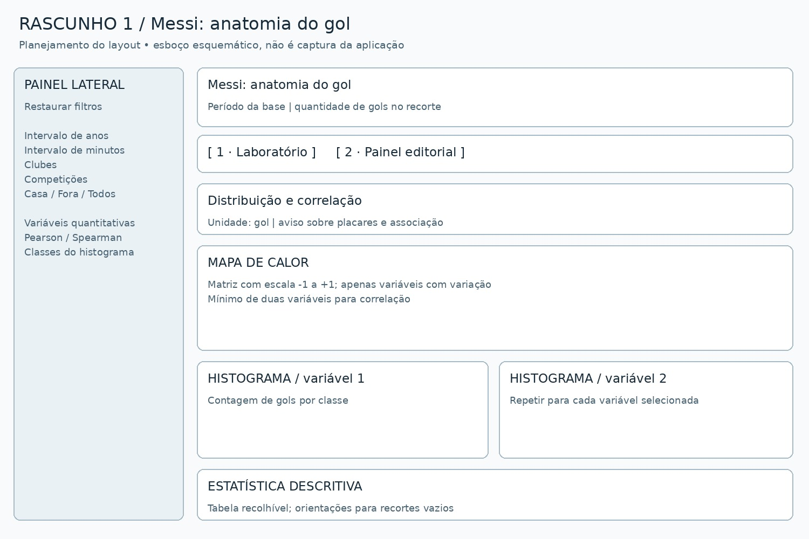
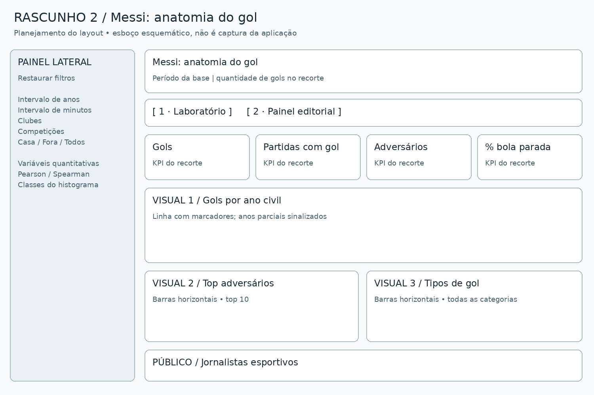

# Messi: anatomia do gol ⚽

Aplicação acadêmica em Streamlit com dois dashboards, baseada na EDA de um arquivo de gols de Lionel Messi. O laboratório explora distribuições e correlações. O painel editorial ajuda **jornalistas e produtores de conteúdo esportivo** a identificar pautas sobre trajetória, adversários e tipos de gol.

**Autor(a):** Lucas Souto Maior Caldas  
**Repositório público:** https://github.com/Souto1002/gols_messi  

## O que há no app

- **Painel lateral:** seleção de quantitativas, intervalos de anos e minutos, clubes, competições e mando; restauração dos filtros.
- **Aba 1 — Laboratório:** mapa de calor de Pearson ou Spearman, um histograma para cada variável selecionada e estatística descritiva. Tratamento de zero/uma variável, constantes e recortes vazios.
- **Aba 2 — Painel editorial:** quatro KPIs (gols, partidas com gol no recorte, adversários e percentual de bola parada) e três visuais (gols por ano, top 10 adversários e tipos de gol).
- Download do recorte, cache de leitura e tema visual em `.streamlit/config.toml`.




## Rodar localmente

Recomendado: **Python 3.12** (versão utilizada nos testes).

```bash
python -m venv .venv
```

Ative o ambiente:

```bash
# Linux / macOS
source .venv/bin/activate
# Windows PowerShell
.venv\Scripts\Activate.ps1
```

Na raiz do projeto:

```bash
python -m pip install -r requirements.txt
python -m streamlit run app.py
```

Abra o endereço exibido no terminal, normalmente `http://localhost:8501`.
O CSV tratado já está incluído; não é necessário executar o notebook antes do app.

## Reproduzir a análise e testar

```bash
python -m pip install -r requirements-dev.txt
python scripts/preparar_dados.py
python -m pytest -q
```

Abra `notebooks/eda_revisada.ipynb` no VS Code ou Jupyter, selecione o ambiente Python e execute todas as células. O notebook usa caminhos relativos à raiz e exporta os dataframes original e tratado. Já acompanha resultados executados. O arquivo `eda_original.ipynb` preserva o anexo original como histórico; contém os caminhos e condições antigas e não é o notebook de reprodução.

Capturas reais do app local: [Laboratório](entregas/dashboard1-local.png) e [Painel editorial](entregas/dashboard2-local.png).

O GitHub Actions executa os testes a cada push e pull request. Evidências e limites em [entregas/relatorio-testes.md](entregas/relatorio-testes.md).

## Dados e interpretação

O arquivo anexado à atividade contém **790 registros de gols de clubes**, entre **05/09/2004 e 07/03/2026**, 518 partidas distintas com gol e 125 adversários. Inclui Barcelona B, Barcelona, PSG e Inter Miami; não inclui a seleção argentina. Esses valores descrevem o arquivo fornecido e não certificam a completude histórica dos registros.

A origem externa, autoria e licença do dataset **não foram informadas no anexo**. O CSV foi incluído conforme solicitado para reprodução; antes da publicação pública, confirme com o responsável pela base a permissão de redistribuição e preencha a atribuição em [data/README.md](data/README.md). Os PDFs das aulas foram consultados, mas não são redistribuídos neste projeto.

Não há jogos sem gol, minutos jogados ou chutes. Assim, os painéis não calculam conversão, gols por 90 minutos ou média sobre todas as partidas disputadas. Os anos de borda podem ser parciais.

A unidade do laboratório é **gol**. O placar final se repete em partidas com vários gols de Messi, e o placar após o gol integra o placar final. Isso produz dependências; correlação não demonstra causalidade. Categorias não são codificadas artificialmente para o heatmap. As quantitativas são minuto, somas dos dois lados dos placares informados e ano opcional. Há placares como `7:9` e `10:11`, cuja convenção de inclusão de disputas por pênaltis não está documentada; não se interpretam essas somas como totais certificados de gols no tempo jogado. Consulte o [dicionário](data/README.md).

## Estrutura

```text
app.py                         # aplicação com as duas abas
requirements.txt               # dependências do app
requirements-dev.txt           # notebooks e testes
ROTEIRO.md                     # GitHub, deploy e entrega
.streamlit/config.toml         # identidade visual e telemetria desativada
data/raw/messi_all_goals.csv    # base fornecida
data/clean/dataset.csv          # base tratada versionada
notebooks/eda_original.ipynb    # anexo histórico preservado
notebooks/eda_revisada.ipynb     # EDA corrigida, ampliada e executada
src/dados.py                   # transformações, filtros e métricas
scripts/preparar_dados.py       # reprodução da base tratada
entregas/                      # dois rascunhos, métricas e testes
prompts/                       # registro de uso de IA
tests/                        # dados e Streamlit AppTest
.github/workflows/tests.yml    # validação automatizada
```

## Entrega e uso de IA

Os dois rascunhos estão em `entregas/`. A justificativa completa dos quatro KPIs está em [entregas/justificativa-metricas.md](entregas/justificativa-metricas.md).

O projeto foi desenvolvido com assistência de IA a partir do enunciado e anexos fornecidos. Leia [prompts/declaracao-uso-ia.md](prompts/declaracao-uso-ia.md) e revise o código e as interpretações antes da apresentação. O aluno deve preencher sua identificação e registrar as verificações reais de publicação. Não foi criado um histórico fictício de commits das aulas.
